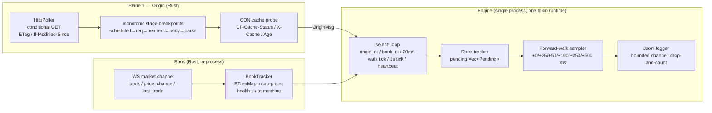
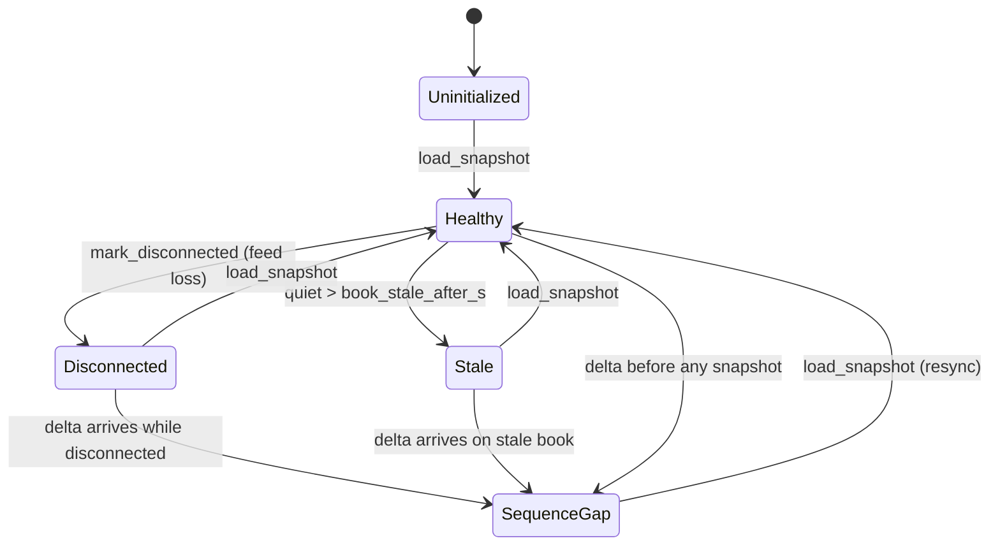

# Poly-Latency Arbitrage

> **cashcat** — a read-only, dry-run measurement harness for *public-information latency arbitrage* on binary prediction markets (Polymarket CLOB).  
> It does **not** trade. It measures whether a tradeable window ever exists.

<p align="center">
  
  
  
  
</p>

---

## 1. The quant thesis in one paragraph

We are **not** predicting the future. We are claiming that, conditional on a clean, deterministic public release, a prediction market's conditional probability is temporarily inconsistent with the newly public state of the world — and that this inconsistency persists long enough (and deep enough) to survive fees, slippage, adverse selection, and our own execution latency.

In quant language this is an **event-driven relative-value strategy with an information-diffusion alpha signal**: a conditional event-study model with an execution-constrained alpha filter. The entire thesis collapses to one measurable object:

$$
\text{T2P}_i = t_{\text{market repriced},i} - t_{\text{origin available},i}
$$

and the strategy is viable only if, repeatedly across independent events:

$$
\text{T2P}_i > T_{\text{you},i} + \text{cost-adjusted margin}
$$

with real, executable liquidity at the delayed quote.

---

## 2. Why this is a measurement problem first

The cheapest failure mode is building execution before knowing whether an edge exists. `cashcat` is **v1 only**:

<|end|> Version | Scope |
|---|---|
| **v1** | detect, timestamp, log, replay, analyze *(this repo)* |
| **v1.5** | validate edge across 10–20 releases per market type |
| **v2** | pre-sign and execute only high-confidence opportunities |
| **v3** | production risk controls, reconciliation, alerting, capital mgmt |

There is **no wallet, no signing, and no order-placement code path** anywhere in this repository. If the logs never show a tradeable window, that *is* the answer.

---

## 3. System architecture



### Crate map

| Crate | Responsibility | Key types |
|---|---|---|
| `crates/clob` | Read-only Polymarket client: market discovery (`/sampling-markets`), REST `/book` snapshots, WSS market channel | `MarketDoc`, `Book`, `ws::run_market_feed`, `parse_event` |
| `crates/feeds` | Origin adapters — `HttpPoller` with conditional GET, body-SHA256 fallback, per-poll monotonic breakpoints, CDN cache state | `HttpPoller`, `OriginEvent`, `is_change` |
| `crates/engine` | The `cashcat` binary: `list` (discovery incl. `--zero-delay`) and `watch` (race logger + forward walk) | `Config`, `BookTracker`, `walk::sweep_asks`, `walk::judge` |

### Clock discipline (three domains, never mixed)

- **Local monotonic (`Instant`)** — every latency difference inside the process.
- **Local UTC wall (`SystemTime`)** — correlation/logging only; never latency math.
- **Exchange/feed timestamps** — context only; own skew and granularity.

Core race measurement: `reaction_latency = t_book_change − t_origin_detected`, both captured by the same process on the same monotonic clock.

---

## 4. The race lifecycle

1. **Origin poll** returns a changed body (or a 304 / identical hash → logged as `origin_event`, no race opened).
2. A `Pending` race is pushed with `t0 = ev.t_headers_rx` (conservative: assumes mutation at window start).
3. The current best bid/ask and `BookHealth` are snapshot into the race.
4. On every book update, `on_quotes` checks for a **material** move (price moved beyond threshold **and** depth ≥ `min_depth_usd`); first such move resolves the race with `latency_ms`.
5. Regardless of first move, the **forward-walk sampler** keeps taking multi-level VWAP sweeps at `+0, +25, +50, +100, +250, +500 ms`.
6. After all six samples land, `walk::judge` emits a verdict.

### Forward-walk offsets and verdicts

| Verdict | Condition |
|---|---|
| `EXECUTABLE_EDGE` | book continuously healthy **and** `net_if_win ≥ min_profit_usd` at +0, +100, **and** +250 ms |
| `PHANTOM_EDGE` | profitable at +0 ms but `net_if_win ≤ 0` by +100 ms (MM cancel beat our transit) |
| `NO_EDGE` | everything else |

The +100 ms sample is the **conservative execution delay** gate — the edge must survive it, not just look good at +0 ms.

---

## 5. Publication uncertainty (the pessimistic bound)

Polling gives an interval, not an instant. If the previous poll returned old state at `t_prev_req_sent` and the next poll first returns new state at `t_curr_headers_rx`:

$$
t_{\text{pub}} \in [t_{\text{prev\ req\ sent}},\; t_{\text{curr\ headers\ rx}}]
$$

Conservative analysis assumes the origin changed at the **start** of the window, so the lead is

$$
\widehat{\Delta}^{\text{cons}} = t_{\text{react}} - t_{\text{prev\ req\ sent}}
$$

not `t_react − t_curr_headers_rx`. If the edge survives this pessimism, the result is credible.

Each poll records four monotonic breakpoints: scheduled → req sent → headers rx → body rx → parse done, plus `uncertainty_ms = this_headers_rx − prev_req_sent`.

---

## 6. Book health state machine



Prices are stored as **integer micro-prices** (`price × 1e6`) in `BTreeMap<u64, f64>` so ordering is exact and cheap. Deltas applied to an unverified book are **dropped** and flag `SequenceGap` — a reconnect can otherwise look like (or hide) a repricing. Races and forward-walk samples are only credited from a `Healthy` (or `Stale`-but-present) book.

---

## 7. Sweep math (multi-level VWAP)

For a target notional $N$ and cap price $p_{\text{cap}}$, walk ask levels ascending:

$$
\text{spent} = \sum \min(N - \text{spent so far},\; \text{size}_k \cdot \text{price}_k)
$$

stopping when the next level exceeds $p_{\text{cap}}$. Then

$$
\text{net\ if\ win} = (\text{shares} \times \$1.00) - \text{spent} - \text{fee}
$$

with `fee = (fee_bps / 10000) × max(0, shares − spent)`. The cap (~\$0.95) guarantees ≥ 5% gross if the outcome holds.

---

## 8. Configuration (pre-declared spec)

`watch --config <json>` locks the definition of "market reacted" and "valid signal" **before** the release window opens (anti-overfitting).

```json
{
  "targets": [{
    "id": "quake-nov07-under-5.3-YES",
    "token_id": "7808...6927",
    "origin": { "url": "https://earthquake.usgs.gov/.../all_day.geojson", "interval_ms": 3000 }
  }],
  "target_notional_usd": 10.0,
  "cap_price": 0.95,
  "taker_fee_bps": 0,
  "min_depth_usd": 25.0,
  "min_profit_usd": 1.0,
  "book_stale_after_s": 120,
  "window_s": 60,
  "heartbeat_s": 30
}
```

| Field | Meaning |
|---|---|
| `target_notional_usd` | simulated size swept across levels |
| `cap_price` | never pay more than this per share |
| `min_depth_usd` | minimum displayed depth for a "material" move |
| `min_profit_usd` | EXECUTABLE_EDGE profit floor at +100/+250 ms |
| `book_stale_after_s` | quiet-period before `Healthy → Stale` |
| `origin.interval_ms` | poll cadence (floored at 200 ms) |

---

## 9. Market discovery

```bash
# Discover active markets (sampling-markets endpoint, not /markets which walks oldest-first)
cargo run -p cashcat -- list --max-pages 8 --url-only

# Only zero-taker-delay markets (seconds_delay == 0) — the only snipeable ones
cargo run -p cashcat -- list --regex "(?i)(noaa|tsa|box office)" --zero-delay
```

`--zero-delay` filters out markets with `seconds_delay: 3` (the live-sports buffer that freezes taker orders for 3 s). See `docs/EXECUTION-REFERENCE.md §1`.

---

## 10. Usage

```bash
# Build
cargo build --release

# Run a measurement session (Ctrl-C to stop; log lands in data/race-<ts>.jsonl)
cargo run -p cashcat -- watch --config configs/earthquake-2026-11-07.json

# Analyze
python scripts/analyze_races.py data/race-*.jsonl
```

### Log kinds (JSONL, one object per line)

`origin_event` · `race_opened` · `book_change` · `race` · `forward_walk_sample` · `forward_walk_verdict` · `race_timeout` · `heartbeat` · `session_end`

The logger is **non-blocking**: a bounded channel with drop-and-count backpressure — it never stalls the feed handler. `logger_drops` is emitted in every heartbeat and at session end. If the logger fails during the fastest releases, evidence is systematically biased — hence heartbeats and explicit completeness records.

---

## 11. Safety properties (by construction)

- **No keys, no signing, no orders.** The `clob` crate has no auth, no signing, no order placement.
- **Polite polling.** Single IP, no proxy rotation, 200 ms floor between polls. Conditional GETs so 304s dominate.
- **Read-only WSS.** Market channel only; no user channel, no order stream.
- **CDN poisoning detection.** `Age > 0` or `HIT` during the release window voids the measurement.
- **Pre-declared thresholds.** Reprice threshold, depth, persistence, cap price, and offsets are config-locked before data collection.

---

## 12. Tests

```bash
cargo test --workspace
```

Coverage includes: market-doc lenient parsing (string/number/bool fields), `seconds_delay` shapes, best-quote selection, change detection, interval floor, `BookTracker` snapshot/delta/health transitions, sequence-gap handling, disconnect/stale, asks ascending, multi-level VWAP sweep, cap respect, empty book, fee on winnings, and verdict classification including live-offset jitter tolerance.

---

## 13. Go / no-go scorecard (per market type, 10–20 releases)

| Metric | Fail | Pass |
|---|---|---|
| Completeness rate | < 95% captured cleanly | 100% with book Healthy |
| CDN cache poisoning | `Age > 0` / `HIT` in window | `DYNAMIC`/`MISS`/`BYPASS` verified |
| Uncertainty bound `W` | ≥ reaction latency | < 25% of reaction latency |
| Ambiguity / revision rate | > 0% flips outcome | 0% ambiguity |
| Phantom-edge decay | EV → 0 by +100 ms | net profit > \$1 on \$10 persists at +100 and +250 ms |
| Confirmed reaction latency | < 150 ms | > 400 ms with depth ≥ \$25 |

Only after this scorecard passes does execution (v2) become a conversation.

---

## 14. Roadmap

- [x] v1: detect, timestamp, log, replay, analyze
- [x] Origin poller with monotonic breakpoints + CDN cache probe
- [x] Book health state machine + micro-price ordering
- [x] Forward-walk at +0/+25/+50/+100/+250/+500 ms
- [x] Phantom vs executable verdict
- [ ] v1.5: 10–20 release validation per market type
- [ ] v2: pre-signed FAK orders (deferred — `docs/EXECUTION-REFERENCE.md`)
- [ ] v3: risk controls, reconciliation, capital management

---

## 15. Further reading

- `docs/BLUEPRINT.md` — strategy thesis (claims to verify, not measurements)
- `docs/MEASUREMENT-SPEC.md` — measurement discipline, version gates
- `docs/EXECUTION-REFERENCE.md` — deferred v2 execution mechanics (reference only)
- `docs/context.md` — raw source dump

---

> **Disclaimer.** This repository measures. It does not trade, hold funds, or sign transactions. Nothing here is financial advice. All "edge" claims in the blueprint are hypotheses to be falsified by the harness, not results.
